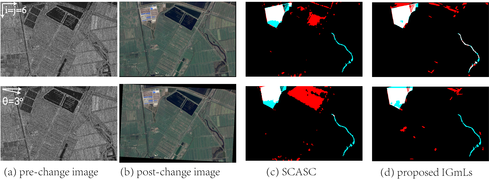

# IGmLs — Python port

Iterative Global Mapping–Local Searching for heterogeneous change detection with unregistered images.

A Python (NumPy/SciPy/scikit-image) port of the reference MATLAB implementation by Sun et al.
(IJCV 2026), packaged as the base for an engineering graduation project (problem **P5**).



*Paper example: SAR pre-change vs. optical post-change image with a 6 px shift (top) and a 3° rotation
(bottom). (c) SCASC, (d) IGmLs. White = TP, red = FP, black = TN, cyan = FN.*

## Status

Working port, **not yet validated against the MATLAB original**. Read
[docs/problem-inventory.md](docs/problem-inventory.md) before relying on any number it produces —
in particular the bundled datasets are optical/optical, not heterogeneous.

## Quick start

```bash
python -m venv .venv && source .venv/bin/activate
pip install -e ".[dev]"
python run_demo.py --dataset 2      # or --dataset 1
pytest
```

The demo prints OA / kappa / F1 per iteration and writes a figure and the maps to `results/`.

## Layout

| Path | Purpose |
|---|---|
| `igmls/core.py` | Main algorithm (global mapping library, local offset search, iteration) |
| `igmls/mrf.py` | Superpixel graph + min-cut change labelling |
| `igmls/features.py`, `normalize.py`, `superpixels.py`, `metrics.py`, `viz.py` | Supporting pieces |
| `run_demo.py` | Demo on the bundled datasets |
| `tests/` | Unit and synthetic recovery tests |
| `datasets/` | Two optical/optical pairs with change ground truth |
| `docs/` | Problem inventory, porting notes, assets |

## Documentation

- [docs/problem-inventory.md](docs/problem-inventory.md) — what is missing or wrong, by category
- [docs/benchmarks.md](docs/benchmarks.md) — published references for the California set and how our port compares
- [docs/results-california.md](docs/results-california.md) — controlled-misregistration results on a real SAR/optical pair
- [docs/porting-notes.md](docs/porting-notes.md) — how the MATLAB code maps to Python and where it deviates

## Provenance

This is a Python port of the authors' public MATLAB implementation (MIT, © 2024 yulisun). The MATLAB
sources are intentionally not part of this repository; see
[docs/porting-notes.md](docs/porting-notes.md) for how each file maps and where the port deviates.

If you use this work, cite the paper:

```bibtex
@article{SUN20260111,
  title   = {Iterative Global Mapping-Local Searching for Heterogeneous Change Detection with Unregistered Images},
  journal = {International Journal of Computer Vision},
  volume  = {134},
  pages   = {1-22},
  year    = {2026},
  doi     = {10.1007/s11263-025-02719-6},
  author  = {Yuli Sun and Junzheng Wu and Han Zhang and Zhang Li and Lin Lei and Gangyao Kuang}
}
```

The original MATLAB code used graphCutMex (Osokin) and GMMSP superpixels (Ban); cite their papers if you
use those components.
