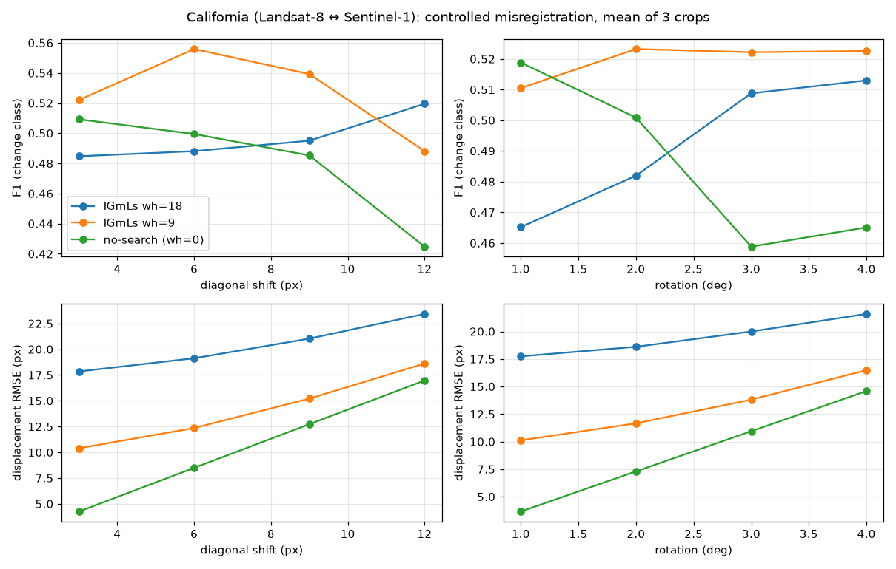

# Results: California (Landsat-8 ↔ Sentinel-1), controlled misregistration

Reproduce: `python experiments/eval_california.py && python experiments/plot_california.py`
(needs `data/UiT_HCD_California_2017.mat`, the UiT/Luppino California set; not committed, 344 MB).

## Setup
- Image 1 = Landsat-8 (11 bands), image 2 = Sentinel-1 (3 log channels, already log-transformed, so
  both images use the `optical` min–max normalisation).
- 3 crops of 512×512 px chosen as the non-overlapping windows with the most change (>5 % changed).
- Image 2 is shifted diagonally by 3/6/9/12 px or rotated by 1/2/3/4° (bilinear, about the window
  centre). Change ground truth stays in the image-1 frame. True per-pixel displacement is known and
  validated against the transform (mean error 0.02 on a blocky test image).
- Methods: **no-search** (`wh=0`: same difference measure + MRF, no local search), **IGmLs `wh=9`**,
  **IGmLs `wh=18`**; `Nf=1000`, `Nc=200`, `Niter=2`, `ws=3`, SLIC superpixels. Scores use the last
  iteration and exclude the `wh` border.
- Metrics: change-class F1 and kappa; displacement RMSE (px) and share of pixels within 3 px.

Raw numbers: `assets/california_results.csv`. Means over crops (full table in `results/california/table.md`):

| condition | no-search F1 | wh=9 F1 | wh=18 F1 | no-search RMSE | wh=9 RMSE | wh=18 RMSE |
|---|---|---|---|---|---|---|
| registered | 0.513 | 0.518 | 0.496 | 0.0 | 9.6 | 17.6 |
| shift 6 px | 0.499 | 0.556 | 0.488 | 8.5 | 12.4 | 19.1 |
| shift 12 px | 0.425 | 0.488 | 0.520 | 17.0 | 18.6 | 23.4 |
| rot 3° | 0.459 | 0.522 | 0.509 | 10.9 | 13.8 | 20.0 |

## What the data says
1. **Change detection degrades gracefully; registration recovery does not work.** Against the
   no-search baseline, `wh=9` gains up to +0.06 F1 under 6–9 px shifts and 2–4° rotation, and
   `wh=18` helps at 12 px. But the estimated displacement is no better than guessing.
2. **The displacement estimates are close to random.** On the already-registered pair, `wh=9` returns
   RMSE 9.6 px (random offsets over the ±9 px grid would give ≈ 8.5 px) and only 7 % of pixels
   within 3 px. The no-search baseline, which always predicts zero, has a *lower* RMSE than IGmLs in
   every condition.
3. **The search mechanism itself works.** A control run of the same code with Landsat-8 as both
   images (6 px shift) finds the true (6, 6) offset as the most frequent one, with 56 % of pixels
   within 3 px. The failure appears with the Landsat-8 ↔ Sentinel-1 modality gap.
4. **Paper-default superpixel counts do not fix it** (`Nf=2500`, `Nc=500`: RMSE 12.4 px, 12 % within
   3 px on one crop at 6 px shift).
5. **Larger windows are worse at registration.** `wh=18` has RMSE ≈ 18–23 px in every condition,
   i.e. wrong offsets get *more* freedom.

## Caveats
- SLIC replaces GMMSP; MATLAB parity unverified. This may explain part of the gap to the paper.
- 3 crops, one scene, one seed: no confidence intervals. F1 differences of ±0.03 are not conclusive.
- The `wh=18` setting is near the edge of what 3° rotation of a 512 px window requires (≈ 19 px at corners).
- OA is not reported in the table because predicting "no change" already scores ≈ 0.88–0.95.
- A guard was added to `core.py` (not in the MATLAB original): if the MRF labels almost everything
  as change, the library update is skipped instead of crashing on an empty KNN library.
